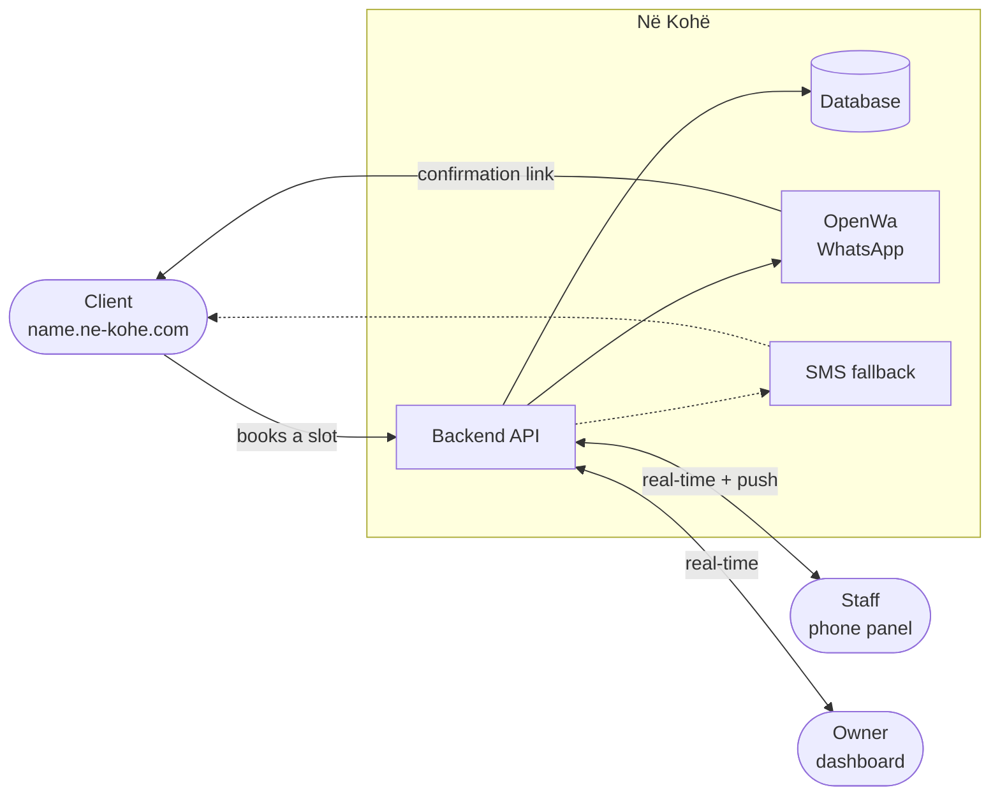

# Erion Troni

**Full-stack developer, backend-heavy.** .NET on the server, React + TypeScript on the front. Software engineering student in Kosovo.

Most of my time goes into APIs and the infrastructure around them, but I build the frontends too. Lately that means Clean Architecture in .NET 10, SQL Server, Docker Compose, and getting things online from a laptop running Ubuntu Server in my room.

> Most of my code lives on **[GitLab](https://gitlab.com/eriontroni)**. I use it mainly for the runners and CI/CD pipelines.

  

---

## Working on

### [Në Kohë](https://ne-kohe.com) · *in production*

Online booking for service businesses (barbershops, salons, dental clinics, nail studios) in Kosovo, Albania and North Macedonia.

- Clients book from a branded page (`name.ne-kohe.com`): pick a service, a staff member and a free slot. No account needed
- Confirmations go out over WhatsApp (OpenWa), with SMS fallback. Unconfirmed slots are released after 30 minutes
- Staff get a phone panel with their daily timeline, push notifications and walk-in booking
- Owners get a dashboard with KPIs and charts, plus staff, services, working hours and branding
- Real-time sync across the client, staff and owner views

## Homelab

An old laptop running Ubuntu Server with 3 GB of RAM.

- Everything containerized
- Memory limits set per service
- Health checks on every container
- Nginx in front of the static builds

The RAM constraint is annoying, but it forces you to actually understand what each process is doing.

## Stack

| Area | Tools |
| --- | --- |
| **Backend** | C# · .NET · ASP.NET Core · EF Core · SQL Server · Redis |
| **Frontend** | React · TypeScript · Vite |
| **Infra** | Docker · Nginx · Linux · Cloudflare Tunnel · Git |

## Contact

- Site: [erion.troni.dev](https://erion.troni.dev)
- GitLab: [gitlab.com/eriontroni](https://gitlab.com/eriontroni)
- LinkedIn: [linkedin.com/in/eriontroni](https://linkedin.com/in/eriontroni)
- Email: [eriontroni@gmail.com](mailto:eriontroni@gmail.com)
